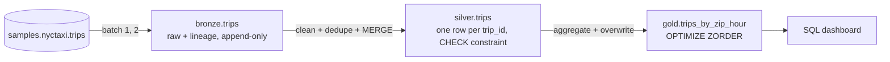

# NYC Taxi Lakehouse

A small medallion pipeline on Databricks with **PySpark** and **Delta Lake**, built to show
correct use of Delta: idempotent `MERGE`, schema enforcement and evolution, constraints,
time travel, and file layout optimization. Transformation logic is unit-tested locally.

## Architecture



## Delta Lake features — where to find them

| Feature | Where |
|---|---|
| Idempotent upsert with `MERGE` | `notebooks/02_silver.py`, `transforms.upsert_trips` |
| Table history / operation metrics | `02_silver.py`, `04_delta_features.py` |
| Schema enforcement | `04_delta_features.py` §1 |
| Schema evolution (`mergeSchema`) | `04_delta_features.py` §2 |
| `CHECK` constraint | `02_silver.py`, `04_delta_features.py` §3 |
| Time travel + `RESTORE` | `04_delta_features.py` §4 |
| `OPTIMIZE ... ZORDER BY` | `03_gold.py` |

## Design decisions

- **MERGE instead of overwrite in silver.** Batches can be replayed or arrive late; MERGE on
  `trip_id` makes every run idempotent and only touches changed rows.
- **Hash key.** The source has no trip id, so `trip_id` is a SHA-256 of the columns that
  identify a trip. Nulls are replaced by a sentinel so they cannot collide.
- **Dedupe before MERGE.** MERGE fails if several source rows match one target row, so each
  batch keeps only its latest ingestion per `trip_id`.
- **Append-only bronze.** Bronze is the replayable record of what arrived; duplicates are
  resolved downstream, never by rewriting raw data.
- **Overwrite in gold.** It is small and fully derived from silver, so a full rebuild is
  simpler and always consistent.
- **ZORDER on `pickup_zip`.** It is the column dashboards filter on.
- **Logic outside notebooks.** `src/taxi_pipeline/transforms.py` holds pure functions, so the
  rules are tested without a cluster; notebooks only orchestrate.

## Run it on Databricks

1. Workspace → **Create → Git folder** → paste this repo's URL.
2. Run `notebooks/01_bronze.py` with `batch_id = 1`, then `02_silver.py`, then `03_gold.py`.
3. Re-run `02_silver.py` with the same batch: the row count does not change (idempotency).
4. Run `01` and `02` with `batch_id = 2`: silver grows.
5. Run `04_delta_features.py` top to bottom.

The default catalog is `workspace` (Databricks Free Edition); change the `catalog` widget if needed.

## Dev environment (GitHub Codespaces)

Nothing to install locally. The repo ships a Dev Container (`.devcontainer/`) with
Python 3.12, Java 17, uv and the Databricks CLI.

[](https://codespaces.new/juangdanilo/nyc-taxi-lakehouse)

1. In GitHub → **Settings → Codespaces → Secrets**, add `DATABRICKS_HOST` and
   `DATABRICKS_TOKEN` and grant them to this repo (needed only for deploying).
2. **Code → Codespaces → Create codespace on main**.
3. In the terminal:

```bash
uv run pytest                 # unit tests, local Spark + Delta
databricks bundle deploy      # deploy the Workflow job
databricks bundle run taxi_pipeline
```

## Deploy as a Workflow job

`databricks.yml` is a [Databricks Asset Bundle](https://docs.databricks.com/aws/en/dev-tools/bundles/)
that defines the job `nyc-taxi-pipeline`: bronze → silver → gold, with `batch_id` and
`catalog` as job parameters. Requires the [Databricks CLI](https://docs.databricks.com/aws/en/dev-tools/cli/install).

```bash
databricks auth login --host <your-workspace-url>   # skip in Codespaces: secrets handle auth
databricks bundle validate
databricks bundle deploy
databricks bundle run taxi_pipeline --params batch_id=2
```

## Run the tests locally

Requires Java 17 and [uv](https://docs.astral.sh/uv/).

```bash
uv run --python 3.12 pytest
```

The same tests run on every push and pull request via GitHub Actions (`.github/workflows/ci.yml`).

## Next steps

Auto Loader / streaming ingestion, and an ML model on silver tracked with MLflow.
